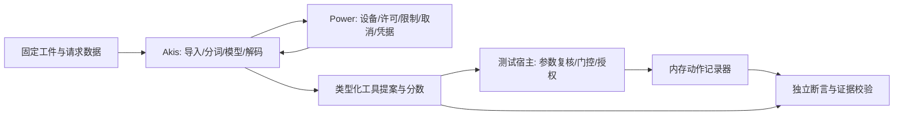

# A3S Akis 全功能端到端测试规划

状态：验收设计，**不是全功能通过证书**。日期：2026-10-13。

## 1. 目标与适用范围

Akis 是基于 Power embedded inference 的模型 crate。目标是证明从模型工件到
宿主动作提案的完整链路，并分别证明计算兼容、语义质量、资源安全和交付可复现性。
一个成功的工具调用样例不能代替以上证明。

本规划的完整目标是 Needle 3 **文本推理**：模型导入、分词、前向、增量解码、
工具选择与参数、结构化提取、embedding、置信度、会话、宿主集成和本地部署。
训练、Whistle 语音、WebAssembly、远程服务列为扩展验收轨道；它们尚未实现，
不得因为底层 Power 或上游 Needle 支持而标为 Akis 已支持。

当前基线：

| 能力 | 当前实现 | 当前证据 | 尚未证明 |
| --- | --- | --- | --- |
| Needle 3 `.cact` | 容器解析、CQ 解码、F32 CPU 权重 | 真实 581 张量工件加载；截断与部分非法输入单测 | 全格式组合、模糊测试、峰值内存 |
| 分词 | 内嵌 BPE、特殊 token、byte fallback | 合成单测；3 条真实输入与上游 token IDs 一致 | 全 Unicode 与多语言差分 |
| 模型前向 | GQA、卷积、engram、Monarch、mHC、A8 数值模拟 | 保留的 9 条边界差分仍在；同一入口另有 1280/1536/2048 token、20 层逐层 lane mean、激活量化最终隐藏，以及重测的 1025 token，top-1 相同 | 最大上下文 8192、第二层深、原生行为兼容、跨平台 |
| 生成与工具调用 | 贪心生成、schema 子集约束、返回前复核 | 真实进程测试 13/17，通过与失败全部留存；grammar 单测 | 中文、否定、缺参数失败；全场景语义、批量与多轮 |
| 置信度 | 原始 head sigmoid 与 token 概率分开返回 | 字段存在；无 head 不伪造值 | 官方最终 confidence 等价、业务校准 |
| Embedding | embedding head 或 confidence probe pool | confidence pool 3072 维归一化/确定性；JAX cosine 0.99991 | 检索质量、原生引擎返回契约及 embedding-head 工件差分 |
| Power | 固定版本、CPU 设备、许可、取消、资源检查、receipt | 许可覆盖预处理；有界 BPE 取消；schema/分词/head 预算；真实 receipt 摘要复核；单次 RSS 对照 | 每个阶段真实取消延迟、争用、完整峰值资源、平台矩阵 |
| 宿主动作 | Akis 只返回提案 | API 没有动作执行入口 | Code/Use/Flow/Apofasi 真实集成 |

基线版本与工件哈希在 `docs/evidence/akis/20261013-bootstrap/OUTCOME.md` 留存。
测试状态只允许：待实现、已实现待执行、通过、失败、基础设施阻塞、明确不适用。
必需用例未执行或基础设施阻塞时，所属 gate 不得通过。

## 2. 架构责任与主链路



| 边界 | 所有者 | E2E 必须观察 |
| --- | --- | --- |
| 拓扑、tokenizer、KV 语义、生成策略 | Akis | 对照模型输出；不靠名字或意图词表修正 |
| 设备与执行许可、取消、资源机制 | Power | 一次逻辑请求使用一个许可；失败后释放；实际设备可核查 |
| `.cact` 解码 | Akis | 哈希、格式与尺寸拒绝；不得谎称经过 Power SafeTensors loader |
| 自动执行阈值、授权、人工确认 | 宿主 | 低信心/缺字段/越权均零动作；模型不能授予权限 |
| 工具实施与编排 | Use/Flow/Code 宿主 | 提案与真实执行分离；动作次序与重复执行策略由宿主证明 |
| `choice/score/noul` 概率语义 | Apofasi 适配层 | 全分布、归一化、期望评分、P(true)，不得用布尔值或 head_score 冒充 |

不强制把 Needle 所有算子塞进 Power 静态图。Akis 模型原生控制流可使用 Power
提供的 tensor device；新增通用内核再归属 Power。测试须覆盖真实调用链，不能只
用 fake Power 证明底层接入。模型权重是工件，stdin JSON 是请求数据；产品配置及
测试 suite 使用 ACL。测试 fixture 不携带下载地址授权、真实密钥或生产业务数据。

## 3. 五层测试体系

1. **组件契约**：Rust 单测和 property/fuzz，定位文件边界、数值算子、grammar、状态问题。
2. **独立数值差分**：固定上游 JAX 为 oracle，比较同一组 CQ bytes、token IDs、mask、
   A8 设置与层深；不得用 Akis 的输出生成自己的期望值。
3. **进程 E2E**：从编译后的 CLI 启动，校验退出码、stdout 单份结果、stderr、stdin、
   文件权限与进程清理。真实权重是必需项。
4. **宿主 E2E**：真实 Akis + 真实 Power + 确定性宿主与内存工具记录器。模型必须真实，
   网络设备、发信、支付等外部副作用使用模拟器。
5. **硬件/发布 E2E**：干净机器、断网、目标 CPU/GPU、资源压力、长跑、打包与消费者构建。

Rust 测试承担数学和进程级严格断言；A3S Test TUI ACL 承担终端可观察输出、
超时与被测进程树清理。没有 Web/GUI 产品时，不为凑覆盖率增加浏览器测试。
未来宿主 UI 到位后，再观察真实流程并编写对应 Web/GUI ACL。

## 4. 全功能验收矩阵

P0：阻断当前能力对外发布；P1：阻断对应完整能力声明；P2：优化或扩展能力上线前必需。
以下每个 ID 是一组可参数化用例；实现时每个参数实例生成独立结果，不能整组笼统标绿。

| ID / 优先级 | 场景与注入 | 可观察结果与 oracle |
| --- | --- | --- |
| ART-01 P0 | 固定官方工件，CLI inspect → load → infer | SHA-256、581 张量、几何字段与独立解析一致；实际 forward 成功 |
| ART-02 P0 | 文件不存在、无读权限、目录、空文件、读取中截断 | 有类型错误/非零退出；不 panic、不挂起、不生成动作 |
| ART-03 P0 | 每个长度截断；offset/长度溢出、重叠、不对齐、未知 tag | 分配前拒绝；不得回退猜测格式 |
| ART-04 P0 | NaN/Inf、错误 tensor shape/order、head manifest、非法 permutation | load/执行拒绝；无可用于执行的成功输出 |
| ART-05 P1 | CQ1/2/3/4/ternary，跨字节索引、padding、零 norm | 与独立解码和人工小矩阵相符；不支持的 group 显式拒绝 |
| ART-06 P1 | 同工件更换目录；同文件名换内容；截断下载 | 身份只随 bytes 变化；缺失/损坏不得自动变成其他模型 |
| TOK-01 P0 | 英文、中文、混合、emoji、组合字符、空白、换行、罕见字符 | 逐 token 对照 reference；只接受已声明的正规化行为 |
| TOK-02 P0 | 所有 byte token、分片 UTF-8、未知 token、特殊 marker 相邻 | 编解码无 panic；完整字节组合还原；非法 ID 拒绝 |
| TOK-03 P1 | 最长输入、长重复串、恶意 BPE 合并序列 | 输入界限可预测；时间/内存受预先声明的预算控制 |
| NUM-01 P0 | 单 token、短前缀、英文/中文工具 prompt | tokenizer 精确一致；有限 logits；cosine > 0.999；明确的非近似并列样本 top-1 一致 |
| NUM-02 P1 | norm/RoPE/GQA/卷积/engram/Monarch/mHC 单独启用及组合 | 逐层激活、残差、KV、logits 与独立 oracle 对照；能定位首次漂移 |
| NUM-03 P1 | prompt 长度 1、2、3、255、256、257、1023、1024、1025、上下文边界 | mask、KV window、卷积历史和 engram 边界与 oracle 一致 |
| NUM-04 P1 | 合法 2/4/8/12/16/20 层工件；含/不含各 head | 深度选择/工件几何正确；不支持的变体明确失败，不能标兼容 |
| NUM-05 P1 | 同 prompt 一次 prefill、分块 prefill、逐 token；同后缀 decode | 最终状态与 logits 等价；prefix reuse 不改变语义（相关 API 实现后） |
| GEN-01 P0 | 正常 EOS、tool close、无结束、max_tokens=0/1/上限/超限 | 明确 finished/耗尽；完整与截断结果不可混淆；截断 complete 零动作 |
| GEN-02 P0 | 两次相同请求，中间插入其他请求 | 相同设置结果确定；请求 B 不受请求 A 的 KV/输入影响 |
| GEN-03 P1 | 多轮指代、工具结果回填、reset、跨租户交替 | 仅同一会话继承允许的状态；reset 后独立；无跨租户串话（当前不宣称有会话 API） |
| GRM-01 P0 | object、数组、string/number/integer/bool/null、enum、嵌套 | 每个生成 token 的 prefix 可接受；最终由独立 validator 校验通过 |
| GRM-02 P0 | 多字节 UTF-8、转义引号、反斜线、unicode escape、数值指数 | 不破坏合法值；非法 escape/非整数/非有限数字不能完成 |
| GRM-03 P0 | enum [1,10]、字段顺序、optional 缺省、空 object、多个工具 | 不因候选顺序屏蔽合法解；schema 不允许的字段/工具不可生成 |
| GRM-04 P0 | 重复键、缺 required、未知属性、尾随垃圾、重复结束 marker | 最终拒绝；不把部分 JSON 或重复字段折叠后当成功 |
| GRM-05 P0 | 不支持的 minimum/pattern/$ref/组合约束、无效 schema | 推理前拒绝；不得静默忽略；与支持范围文档一致 |
| GRM-06 P0 | 16/17 层 schema、64/65 字段/数组元素/工具、255/256 enum | 每个边界按明确契约接受或拒绝；grammar 无死循环 |
| TOOL-01 P0 | 单工具显式动作、多个工具竞争、无工具适用 | 工具名和全部参数 exact match；不适用返回空提案或明确拒绝 |
| TOOL-02 P1 | 两个顺序动作、相同工具多次、先查询再写入 | 顺序和参数依赖正确；宿主只执行已验证的完整步骤 |
| TOOL-03 P0 | 否定、引用、第三方转述、缺必填、相互矛盾 | 不产生错误的自动动作；保留拒绝/升级路径，不猜参数 |
| TOOL-04 P1 | 同义改写、大小写、工具重命名、参数重排、相似工具 | 使用精确宿主标识；比较任务质量；无词表补丁 |
| EXT-01 P1 | 发票/预约/工单；可选缺失、多个记录、嵌套记录 | 字段级 precision/recall/F1；无证据字段保持缺失；错误按字段归因 |
| EXT-02 P1 | 单位/时间/相对日期/数值边界/恶意输入内指令 | 只有输入或显式系统事实支持的值可接受；不自行编造日期或身份 |
| EMB-01 P1 | 有 embedding head、仅 confidence head、无可用 head | 维度、有限值、单位范数和回退来源正确；无 head 明确拒绝 |
| EMB-02 P1 | 同文本重复、中文/英文近义与反义、跨领域检索 | 数值差分；独立检索集 Recall@k/MRR；probe fallback 不冒充 contrastive embedding |
| CONF-01 P0 | head 缺失、本地微调工件、量化/深度变化 | 缺失为 None；raw head score 与 token 概率分离；不得标为已校准 |
| CONF-02 P1 | 正确/错误/域外/中文样本；独立校准集与测试集 | reliability diagram、ECE、Brier、risk-coverage；冻结阈值后再测试 |
| CONF-03 P0 | 低于/等于/高于宿主阈值；NaN/Inf/缺失 | 边界行为确定；无有效分数不能获得自动执行许可 |
| PWR-01 P0 | Power default features 关闭；嵌入式构造/运行 | 无 listener、下载、子进程或服务端初始化；receipt 为真实 CPU 设备 |
| PWR-02 P0 | 同 runtime 并发请求与超额请求；失败后再次调用 | 许可数量不超限；拒绝可解释；失败/取消后许可归零 |
| PWR-03 P0 | 取消发生于入场前、prefill、decode、grammar、head、返回前 | 取消可观察且不返回可执行成功；不再产生后续 token；资源释放 |
| PWR-04 P0 | 模型/驻留/input/context/generated/state/tensor 各预算 ±1 | 所有模型自有分配受对应边界约束；Power 不能仅被当作名义依赖 |
| PWR-05 P1 | 同设备多模型、多会话副本、队列满、等待 deadline | 实际接入 session pool/队列后测试；不把 Power 自身单测算作 Akis 集成证据 |
| REC-01 P0 | 重放 receipt；改输入、输出、权重、设备 | 独立重算 canonical digest；正确记录相符，篡改不符 |
| REC-02 P0 | raw logits/生成/embedding/失败/取消各接口 | 定义哪些返回凭据；失败无伪成功；不宣称摘要自带签名或远程证明 |
| HOST-01 P0 | 真实 Akis → 宿主 gate → 内存工具计数器 | 一条合法提案恰好一个预期动作；无模型内置执行 |
| HOST-02 P0 | 越权工具、资源不属于租户、过期授权、重放 | 宿主拒绝且计数为零；模型高分不能绕过授权；幂等性按宿主契约断言 |
| HOST-03 P1 | 工具超时/失败、重试、部分多动作成功 | 不盲目重复不可逆步骤；Flow/Use 接收明确失败和关联 ID |
| APO-01 P1 | Apofasi 三种原语、候选数量与多题 batch | 明确概率语义；全分布归一化；score 为期望；noul 是 P(true) |
| APO-02 P0* | 只有 tool enum/布尔值/head_score 的 Akis 结果 | Apofasi 适配层拒绝假概率，不构造 one-hot 伪置信度；*适配器上线时阻断 |
| SEC-01 P0 | prompt injection、特殊标记、越权动作诱导、schema 诱导 | 结构边界不可越过；语义攻击单独统计；无 shell/文件/网络副作用 |
| SEC-02 P0 | 文本与参数放入唯一 canary；检查日志、receipt、错误 | 无未经授权明文出现在运维证据；响应中的业务文本按 API 契约处理 |
| SEC-03 P0 | 断网运行，监测 socket/connect/子进程 | 推理零外连；缺权重立即失败，不自动访问模型仓库 |
| SEC-04 P1 | importer/tokenizer/schema 随机与结构化 fuzz、超深/超大输入 | 无 panic/越界/无限循环；时间和分配在预算内；最小化反例入库 |
| CLI-01 P0 | 全部子命令、参数缺失、非法整数、未知字段、坏 stdin | 退出码正确；成功 stdout 只含机器结果；错误到 stderr |
| CLI-02 P0 | pipe/PTY、EOF、输出管道关闭、Ctrl+C、测试超时 | 无僵尸和残留被测进程；只清理本次进程树；明确 CLI 的信号语义 |
| CLI-03 P1 | 路径含空格/中文、只读工作目录、无 HOME 缓存 | 本地显式权重可用；不写隐式状态或隐藏配置 |
| PERF-01 P1 | 冷载、warm prefill、逐 token decode、完整 complete/head | 分阶段及端到端 p50/p95/p99；同一硬件/权重/输入/策略对比 |
| PERF-02 P1 | 不同上下文、1/5/24/64 工具、不同 schema 深度和输出长度 | grammar 与神经计算分别计时；报告峰值 RSS、状态和权重字节 |
| SOAK-01 P1 | 2 小时持续负载；候选发布 24 小时；取消/错误穿插 | 无会话泄漏、permit 泄漏、无界内存增长；吞吐退化有原始时间序列 |
| REL-01 P0 | 全新 checkout、锁定依赖构建、独立消费者项目引用 | 无 sibling path 依赖；构建可重现；无上游 C 引擎/Python 推理运行时 |
| REL-02 P1 | macOS ARM64、Linux x86_64/ARM64、Windows x64 | 每个平台单独认证；缺硬件标阻塞，不根据另一个平台推定通过 |
| REL-03 P1 | 二进制安装→断网→load→complete→退出→再次启动 | 用户可复现完整链路；工件/license/provenance 完整 |

## 5. 数据集与独立 oracle

- 小合成权重只验证故障、算子与宿主机制；不能用于模型质量或速度宣称。
- 数值集：至少 100 个固定短输入加全部长度边界；覆盖英/中/混合、特殊字符、
  不同工具/候选数量。记录 tokenizer IDs、选定层张量摘要、最终 logits 与 top-k。
- 任务集：建议首轮冻结 1,200 条人工核查样本，按工具选择、参数、结构提取、
  拒绝/歧义各 300 条；每组至少包含英文和中文。另留组合攻击集，不混入调参集。
- 按任务模板/来源/工具族分 train、calibration、test，避免同一句改写跨集合泄漏。
  Needle 公开 benchmark 单独报告，不能替代 A3S 的真实任务集。
- 每条数据明确：case ID、语言、tool schema 哈希、上下文、预期动作/拒绝、
  参数来源 span、风险级别和标注理由。两人复核高风险样本；争议样本进入仲裁池。
- 独立 validator 必须不是 `Schema::scan` 自己；对支持的 schema 子集采用
  标准 validator 或人工固定期望值，专门加入 numeric enum 前缀与 Unicode 反例。
- 语义指标分别计数：选工具错、漏调用、多调用、参数错、顺序错、应拒未拒、
  可执行请求被拒。全字段 exact match 与 field F1 都报告。

数值验收不能只看 cosine：它可能掩盖 top-1 翻转。预先冻结非近似并列用例，
要求 top-1 一致；近似并列另报告 margin、top-k 和绝对误差，不能失败后才改标签。
tokenizer 必须精确一致。长序列和量化阈值附近单独观察累计误差。

## 6. 发布 gate 与量化准则

| Gate | 阻断条件 | 最小证据 |
| --- | --- | --- |
| G0 工件与结构 | 任一 P0 importer/tokenizer/schema/CLI 用例失败；fmt/clippy/test 失败 | Rust 结果、独立 validator、进程结果 |
| G1 计算兼容 | 短/长上下文、逐层、KV 与 head 差分未通过 | 固定模型/reference/binary 哈希、原始误差与差分报告 |
| G2 功能质量 | 任一核心场景错误；目标语言/工具规模未测；阈值在测试集上调参 | 冻结数据集、混淆统计、分类风险与校准图 |
| G3 宿主安全 | 越权/取消/非法结果产生动作；跨会话污染；receipt 不一致 | 实际宿主调用链、动作账本、canary 与取消记录 |
| G4 运维性能 | 内存/并发超预算、泄漏、未达冻结硬件预算、长跑失败 | 分位数、峰值 RSS、长跑时序、故障恢复 |
| G5 平台交付 | 任一宣称支持的平台缺少真实硬件认证；消费者构建失败 | 干净机器全过程、安装包和许可证证据 |

初始质量门槛为设计建议，必须在冻结测试集前确定并写入受版本管理的 ACL 验收策略：

- 结构安全：支持的 schema 最终通过率 100%；无效/不支持 schema 不得静默成功。
- 核心确定性流程：所有冻结 P0 场景通过，拒绝与取消路径零动作。
- 自动动作风险：若目标错误率上限为 0.1%，不能用几十条零错误声称达标。
  在独立同分布的已接受样本中，约 3,000 次零错误才使单侧 95% 二项上界低于 0.1%；
  同时报告接受率，避免“全部拒绝”的伪成功。高风险类别和语言分别报告，不以总量掩盖。
- 常规任务 exact match 建议先以现有 Needle/Apofasi 同设备基线为非回退目标；
  显著性用配对区间或检验，不能只比较两个百分比。
- 性能先冻结目标硬件和每类请求预算，再执行至少 30 次冷载、50 次 warm-up、
  1,000 次计时请求。不得把 decode tok/s 代替 complete 端到端延迟。
- 原始 head_score 不获得自动执行安全声明；G2 校准和 G3 宿主门控通过后才可启用。

## 7. 测试工程布局与执行

建议布局（标为 planned 的路径不是已经实现的测试）：

```text
src/*_tests.rs                  # 已有：组件测试
tools/parity.py                 # 已有：固定 upstream JAX 数值差分
tests/e2e/terminal-smoke.acl     # 终端表面冒烟
tools/live_e2e.py               # CLI 全进程真实权重检查
tools/certify.sh                # 当前 slice 的认证入口
tests/e2e/cases/                # planned：冻结请求/期望数据，不放密钥
tests/e2e/host/                 # planned：真实 Akis/Power + 动作记录器
tests/e2e/faults/               # planned：取消/预算/进程故障注入
tests/e2e/quality/              # planned：语言/工具规模/风险分层
tests/e2e/platform/             # planned：干净机器/断网/打包认证
fuzz/                          # planned：容器、分词、grammar targets
docs/evidence/akis/<date-slug>/ # 保留 OUTCOME、哈希、原始测量、失败复盘
```

终端 suite 先 `a3s-test check ... --json`，再由 `a3s-test run` 指定真实
`--tui-executable` 和逐个 `--tui-arg`。使用文字/正则等待，无任意 sleep。
CLI 为一次性进程；PTY 结果不能代替 subprocess 的 stdout/stderr/退出码断言。
当前机器 `a3s-test capabilities --json` 因 Web adapter 0.3.2 与要求 0.4.x
不匹配而失败；这是工具基础设施问题。独立的 TUI check/run 已通过，退出码与清理结果均正常。

CI 分层：PR 跑 G0 + 小数值回归；夜间跑完整 CPU 差分、任务矩阵与 2h soak；
发布候选跑所有已宣称能力及平台矩阵、24h soak。真实权重缺失时认证入口明确失败，
不能把整个 live suite skip 后返回绿色。GPU/TEE/语音等扩展未开通时，单独保留未认证状态。

只允许基础设施可重试错误重试；语义/数值/断言失败不通过盲目重试消除。
全套失败后，每个不同失败先单独重跑，区分共享设备争用、用例错误和产品缺陷。
多平台任务未来可分片，但同一设备的性能测量串行；本次没有启动远程 worker。

## 8. 证据与回归规则

每次认证必须绑定：Akis source commit + dirty diff hash（如存在）、Power rev、
Cargo.lock 哈希、Rust 版本、二进制 SHA-256、模型 SHA-256、oracle revision、
case manifest SHA-256、设备/OS、执行参数和时间。禁止把测试期间的未固定 main 当身份。

OUTCOME 写清通过/失败/阻塞/未执行的数量，以及“明确不宣称”。原始结果保留
每个用例退出码、断言、耗时、实际输出摘要、失败类别、清理结果。公开 evidence 只使用
合成任务；真实用户文本保留在受控环境，不能进入 Git 历史。

缺陷修复必须添加能在修复前失败的最小回归，再跑关联链路。不得通过改期望答案、
放宽阈值、删用例或新增意图词表使结果变绿。测试数据与模型训练数据分开版本管理。

## 9. 当前优先工作包

| 顺序 | 工作包 | 出口 |
| --- | --- | --- |
| 1 | 固定当前源码/权重，补独立 validator 与真实 CLI 回归 | G0 当前子集，保留实际证据 |
| 2 | numeric enum 前缀、marker 字符串、Unicode、schema 关联关键词对抗 | 所有支持的 schema 无错误接受与错误屏蔽 |
| 3 | 运行中取消、head/grammar 阶段取消、预算下的峰值分配审计 | G3 机制与 G4 资源边界 |
| 4 | 长上下文、层深、量化与 head/embedding 差分 | G1 完整文本推理 |
| 5 | 冻结中英任务集，独立校准与风险覆盖曲线 | G2，随后允许宿主阈值试点 |
| 6 | Code/Use/Flow 宿主记录器与 Apofasi 契约适配 | G3 宿主；不伪造概率 |
| 7 | packed CQ kernels、KV 驻留优化、跨平台与长跑 | G4/G5；才可宣称设备端低内存性能 |

特别审查项：当前 `Model` 用自有 Rust 控制流调用 Power 提供的 Candle device，
不代表 Power 自动审计了每一个中间分配。状态估算、head pooling 和 grammar 内存必须
通过峰值测量与极限用例证明。目前已补缓冲区预算并实测 1025-token logits 请求峰值
RSS 约 717MB → 536MB；这不构成整个操作系统 RSS 上限或所有输入的分配证明。
2026-10-14 的数值切片在同一 parity 入口增加 1280、1536 和 2048 token、20 层逐层误差和激活量化对照。
2048 token 的 logits 请求在既有状态预算内完成。随后的 engram gather 切片把这些表保持为 CQ，
按行解码；同一 1025-token logits 冷进程峰值 RSS 为 271,843,328 字节，
与保留样本 536,035,328 字节和当时的 536,051,712 字节并列。投影矩阵仍展开为 F32。
随后的布局切片把完整投影在加载时转成连续的 `[in, out]`，每步走连续 GEMV。
同一入口测得 1025-token 冷进程 272,236,544 字节、9.513 秒，2048-token 为
273,121,280 字节、18.793 秒；上一版同一请求是 12.818 秒和 25.622 秒。
余弦仍高于 0.999，top-1 相同。驻留内存没有再下降。
随后的注意力切片对每一行缓存的 value 只做一次宽度检查，再按元素做一次乘和一次加。
同一入口测得 1025-token 冷进程 272,285,696 字节、6.934 秒，2048-token 为
273,170,432 字节、13.406 秒；上一版同一请求是 9.513 秒和 18.793 秒。
hello 与 256-token logits 相对上一版的最大绝对误差为 0。余弦仍高于 0.999，top-1 相同。
驻留内存没有再下降。
随后的因子切片把 Kronecker 乘积的每一行改成同一次乘加。同一入口测得 1025-token
冷进程 271,810,560 字节、6.762 秒，2048-token 为 273,006,592 字节、13.200 秒；
上一版同一请求是 6.934 秒和 13.406 秒。2048-token 样本相差 0.206 秒，落在单次冷样本波动里。
证据记下这个样本，因子乘积到此停止。hello 与 256-token logits 相对上一版的最大绝对误差为 0。
余弦仍高于 0.999，top-1 相同。驻留内存仍在 272,285,696 字节旁边。
随后的分配图覆盖 `step`、`attention`、`mlp`、`kron` 和 gemv 上每个 token 重建的向量。
同一二进制上对 1025-token logits 采样 4 秒，`logits` 3114 次，`flat` 51 次，`to_vec1` 52 次。
秩 1 缩放没有越过缓存线，所以没有第二份拷贝。`gemm_basic` 是栈顶最多的叶子，1781 次。
随后的列拆分试验把较宽的连续乘积按输出列切开，每段仍走同一次连续乘积。
hello 与 256-token logits 相对保留二进制的最大绝对误差为 0。
同一入口的冷进程从 6.762 秒、13.200 秒变成 15.206 秒、32.020 秒，所以这次拆分没有保留。
随后对同一档案、同一状态预算发了一条 8192-token `<think>` logits 请求。请求完成，
冷进程 272,875,520 字节、49.39 秒，余弦 0.999999940，top-1 均为 38。
每一层注意力仍最多看 256 行缓存。状态预算没有提高。
最大上下文、第二层深、packed GEMM 和跨平台仍未证明。这不是 G1 或 G4 完成，也不是 Needle 替换认证。
Unix CLI 已把 `SIGINT` 与 `SIGTERM` 接到进程取消标志。第一次信号请求取消，
第二次相同信号恢复默认终止。`A3S_AKIS_SIGNAL_READY_FILE` 只是进程测试的同步屏障，
设置后命令在信号到达前等待，然后仍走正常失败路径；未设置时 CLI 不会等待。
非 Unix 平台没有安装信号处理器。库层阶段测试不能代替那些平台的 CLI 认证。
随后用固定的原生库 `993d617e` 重放了八条工具样本，并与同一发布二进制的 `complete` 对照。
工具名和参数与 2026-10-13 的对照表相同：英文调用相同，中文、无关和引用样本两边都是空提案，
否定样本两边都发出厨房关灯。`missing-room` 只在原生侧进入 `suppressed_calls`，
Akis 仍返回房间字符串 `living room`。答案、期望和阈值没有改。活动仍是 13 通过 / 4 失败。
这不是原生 ABI 兼容，也不是 G1 完成，也不是 Needle 替换认证。
随后补上测试计划里已经点名、树上还没有的失败关闭检查。41 个库测试和 4 个 CLI 进程测试通过。
缺失路径、空文件和模式 `000` 的文件都非零退出且不 panic。参数个数不足、非整数生成上限、
`complete` 的未知字段同样被拒绝。合成模型上，空 `logits` 和超过 `geometry.context` 一个 token 的请求
返回现有的 `token or context limit exceeded`。生成上限设为 1 时，下一个 token 也返回同一错误。
真实 needle3 上，`"<think>"` 重复 8192 次再加 CLI 的 BOS，共 8193 个 token，进程退出码 1，
stdout 为空，stderr 为 `invalid request: token or context limit exceeded`。状态预算没有提高。
这 17 条活动仍是 13 通过 / 4 失败，`missing-room` 的房间字符串仍是 `living room`。
覆盖引导模糊测试和其余边界矩阵仍在。这不是 G0 完成，也不是 Needle 替换认证。
随后在同一进程里用现有 benchmark 示例跑了 1 次热身和 200 次厨房开灯 `complete`。
进程退出码 0，每次函数调用都与示例里的期望一致，输入都是 59 个 token，输出都是 19 个 token。
冷加载 599.6 毫秒。整段进程 93.88 秒，最大驻留集 279,674,880 字节。原始毫秒列表留在证据里。
这次重复不是分位数门禁，也不是 2 小时 SOAK-01。活动仍是 13 通过 / 4 失败。
这不是 G4 完成，也不是 Needle 替换认证。
随后试了把完整 CQ 投影保持打包，对每个输入组先做一次 Hadamard，再按码本做点积。
hello 的 top-1 仍是 8110，余弦 0.999993753，最大绝对误差 0.17288923。
256-token `<think>` 的 top-1 仍是 38，余弦 0.999996856，最大绝对误差 0.39241982。
同一入口的冷进程，保留二进制是 2.35 秒、272,334,848 字节；单线程试验是 3.49 秒、93,667,328 字节；
按本机 6 个性能核切行是 3.16 秒、93,978,624 字节。2048-token 没有再跑。试验没有保留。
活动仍是 13 通过 / 4 失败。这不是 G4 完成，也不是 Needle 替换认证。
随后，前缀 token 不再做输出投影。最后一个 token、生成时要采样的那一步，以及读出用的缓存更新仍走原来的前向。
hello、256-token `<think>` 和 2048-token `user` 的 logits 相对上一版最大绝对误差为 0，top-1 相同。
同一入口的 2048-token 冷进程是 11.40 秒、272,924,672 字节；同一台机器上的上一版是 12.27 秒、273,121,280 字节，
与保留的 13.200 秒样本并列。一条厨房开灯 `complete` 的 head score 仍是 0.8660065。
42 个库测试和 4 个 CLI 进程测试通过。活动仍是 13 通过 / 4 失败，`missing-room` 的房间字符串仍是 `living room`。
这不是 G4 完成，也不是 Needle 替换认证。

## 10. 扩展轨道的额外出口

- **训练/量化/导出**：固定 seed 的小数据训练、loss 与 held-out 质量、训练→导出→
  重载→推理差分、量化精度退化、训练中断恢复、head 校准失效处理。未实现前不宣称 Rust 全训练栈。
- **语音**：固定采样率/声道、静音噪声拒绝、WER、时间戳、分窗/流式边界、音频→
  工具全链路与支持语言分别认证。Whistle 是独立模型，不能复用文本成绩。
- **GPU/WASM/TEE**：真实设备差分、unsupported device fail-closed、内存预算、
  加载/取消/回退、浏览器 worker 隔离或真实 attestation。Power 的能力不会自动传递成 Akis 认证。
- **远程服务**：仅在服务接口成为明确产品范围后增加鉴权、租户隔离、流式断连、
  背压、限流与恢复 E2E；避免给纯嵌入式 crate 提前增加服务端依赖。
